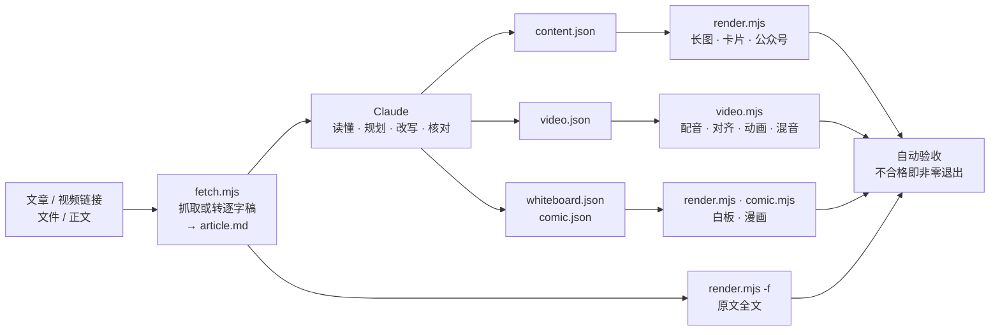
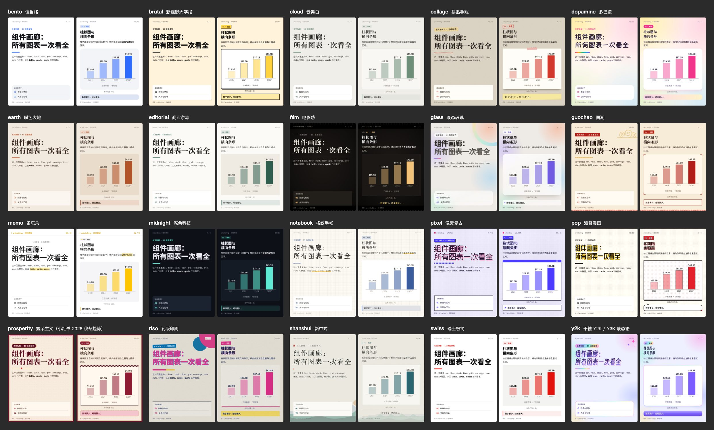
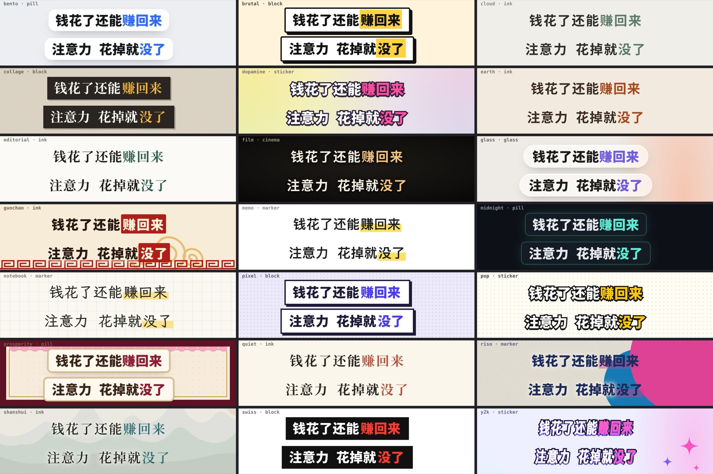

<div align="center">

# article2media

**把一篇文章或一条视频，一键做成小红书图文、公众号排版和口播短视频。**

开源 Claude Code / Codex Skill · 文章或视频进 · 杂志长图 · 小红书卡片 · 公众号图文 · 竖屏口播视频 · 原文排版 · 白板论证 · 漫画

[](CHANGELOG.md)
[](LICENSE)
[](#依赖)
[](#设计原则)
[](#安装)
[](#安装)

</div>

**article2media** 是一个开源的 Claude Code / Codex Skill，同时也是 Claude Code 插件。它把一篇文章或一条视频做成可以直接发布的中文视觉内容。

- **输入**：
  - 文章：X（Twitter）长文、网页、微信公众号文章，或本地 Markdown；
  - 视频：抖音、YouTube、B 站链接，本地视频或音频，`.srt` / `.vtt` 字幕。视频先转成逐字稿文章。
- **产出**：杂志风长图、小红书 3:4 图文卡片、可直接粘贴的公众号排版、带本地 AI 配音和逐字字幕的竖屏口播视频，以及原文全文排版、白板论证图和黑白漫画。
- **验收**：每种产出都自动检查，不合格就报错。
- **依赖**：只需要 Node.js 22 和 Chrome。


<p align="center"><sub>示例：Dan Koe 的 X 长文《The most lucrative AI business to start in 2027》。七种产出各用了一套主题，口播视频用的是「资讯播报男声」。<a href="docs/samples/dan-koe-video.mp4">看示例视频</a> · <a href="#随包音色">听 7 款音色</a></sub></p>

---

## 为什么做这个

好文章在信息流里很难被读完。把它做成图文或视频，通常要截图、排版、配图、配音、剪辑，几个小时才做完一个平台，换个平台还得从头再来。

article2media 把这件事交给 AI。你给一个链接，流程分三步：

1. Claude 先把文章**读懂**，重组成一份和风格无关的结构化内容；
2. 脚本把这份内容**渲染**成各平台需要的格式；
3. 交付前**自动验收**，有问题直接报错，不靠人眼去找。

## 核心特性

| | |
|---|---|
| **文章和视频都能当原文** | 视频先转成逐字稿文章：人工字幕优先，其次平台的原语言自动字幕，都没有时用本地 Whisper 识别。繁体转简体、专有名词纠错、时间轴都会处理好，后面的流程和文章完全一样。 |
| **先读懂，再排版** | 不是截图，也不是机械摘要。Claude 规划结构、改写标题、挑选图表、核对数字，产出只含内容的 `content.json`。版式和主题由脚本负责，换风格不用重写内容。 |
| **一份内容，七种产出** | 长图、卡片（3:4 / 4:5 / 1:1 / 9:16）、公众号、口播视频、原文全文、白板论证、漫画。21 套主题对所有图文产出通用，口播视频沿用主题的配色、字体和卡片样式。 |
| **每种产出都有验收** | 版面检查溢出、截断和重叠。全文模式逐块读回比对原文，改一个字就失败。白板模式要求每段原文都有去向。视频审片检查首句时长、画面静止、语速、字幕闪断和响度。不合格就以非零码退出。 |
| **视频质量达到能发布的水准** | 本地 VoxCPM2 生成 48 kHz 配音，Whisper 逐字对齐，数字和要点在说到的那一刻出现。语速按从容讲解控制在约 4.5 字/秒。字幕不闪烁，样式跟随主题。 |
| **版权与合规写进流程** | 随包 7 款音色全部只凭文字描述设计，不模仿任何真人。克隆音色只留在本机，使用时会提醒。成片首帧和 MP4 元数据都带 AI 生成标识，产出都署原文出处。 |
| **零依赖，本地优先** | 只需要 Node 22 和一个 Chrome。出图、本地配音、逐字对齐都是可选能力，会自动探测。缺了就降级或明确提示，不会自动下载或安装任何东西。 |

## 快速开始

**1. 安装**（Claude Code 与 Codex 全局安装；其他方式见[安装](#安装)）

```bash
npx skills add threerocks/article2media --skill article2media -g -a claude-code -a codex -y
```

**2. 检查环境**

```bash
node ~/.claude/skills/article2media/scripts/doctor.mjs        # Node、Chrome、字体
node ~/.claude/skills/article2media/scripts/video.mjs doctor  # 配音、逐字对齐、出图、ffmpeg（做视频时需要）
```

**3. 在 Claude Code 里调用**

```
/article2media https://x.com/thedankoe/status/2117664712532123680
/article2media https://example.com/post 小红书
/article2media ./notes.md 公众号
/article2media https://x.com/… 做成口播视频
/article2media https://www.bilibili.com/video/BV… 小红书     # 视频进，图文出
```

产出写在当前目录的 `article2media-out/<slug>/` 下。Codex 里用 `$article2media` 调用。

## 七种产出

| 产出 | 规格 | 适合 | 触发方式 | 示例里的主题 |
|---|---|---|---|---|
| **杂志长图**（默认） | 1200 宽，2 倍图，1–4 页；每节有标题、要点、两张图表和一个数据面板，结尾附执行清单 | 把长文读成一份可收藏的拆解 | 不加参数 | `editorial` |
| **卡片组** | 小红书 3:4（1080×1440）、IG 4:5、1:1、9:16；封面 + 每节一卡 + 要点，附发帖文案 | 信息流平台 | 提到比例或平台，或 `--ratio 3:4` | `brutal` |
| **公众号图文** | 样式全部内联，图表以 base64 内嵌，可直接粘贴进编辑器；另出 2.35:1 头图和 1:1 封面 | 公众号 | 提到「公众号」 | `swiss` |
| **口播视频** | 1080×1920 竖屏：封面 → 5 秒内说完的钩子 → 逐字同步的动画、配音和字幕 | 抖音、视频号、小红书视频 | 提到「视频 / 口播」 | `midnight` |
| **原文全文** | 原文一字不改，白底阅读面，正文 40 px / 1.9；逐块校验，过长时在块与块之间分页 | 完整保留原文，只做排版 | `-f` | 白底阅读面 |
| **白板论证** | 一条纵向推理主干：问题、前提、证据、矛盾、转折、结论；每段原文都有去向 | 看清作者怎么得出结论 | `-w` | 白板 |
| **漫画** | 黑白分镜，角色前后一致，对白全部用 HTML 排版；附 3:4 卡片 | 用一个故事讲清一个机制 | `-c` | 黑白漫画 |

可以输入 X 长文、帖子或线程，任意网页，微信公众号文章，本地 Markdown 或文本文件，也可以直接粘贴正文；视频见下一节。英文原文默认改写成中文，需要英文产出时加 `--lang en`。没有提比例或平台时出长图；没有指定风格时，Claude 按内容选一个主题，交付时说明理由。

```
/article2media https://example.com/post --style midnight     # 指定主题
/article2media ./notes.md --style all --pages 2              # 全部主题各出一份
/article2media https://x.com/… 小红书 --illustrate           # 加 AI 插画（封面 + 配图）
/article2media https://x.com/… --verify                      # 联网核对文中的数字
/article2media ./essay.md -f                                 # 原文全文排版
/article2media https://x.com/… -w                            # 白板论证
/article2media https://x.com/… -c                            # 漫画（需要出图能力）
```

## 视频当原文

给一个视频链接或视频文件，`fetch.mjs` 会先把它转成逐字稿文章 `article.md`，时间轴另存在 `transcript/segments.md`。之后要长图、卡片、公众号、口播视频还是漫画，和文章一模一样。

```
/article2media https://www.bilibili.com/video/BV1NprhBPEtR 小红书
/article2media "7.94 复制打开抖音，看看【…】 https://v.douyin.com/…/"     # 整段分享口令也行
/article2media ./访谈录音.m4a 公众号
/article2media ./talk.srt -f
```

| 来源 | 文字从哪来 |
|---|---|
| YouTube | 人工字幕 → 原语言自动字幕（不用机器翻译的字幕轨）→ 本地语音识别 |
| B 站 | 人工字幕 / AI 字幕 → 本地语音识别 |
| 抖音 | 下载视频（优先无水印地址）→ 本地语音识别 |
| 本地视频 / 音频 | 本地语音识别 |
| `.srt` / `.vtt` | 直接解析 |

- **本地语音识别**：用 mlx-whisper 和 whisper-large-v3-turbo，在 Apple Silicon 上运行。实测 6 分钟的 B 站视频 16 秒转完，14 分钟的视频 29 秒转完。
- **清理**：
  - 繁体转简体（内置 OpenCC 字表）；
  - 半角标点改全角；
  - 去掉 Whisper 在静音处编出的套话和重复循环；
  - YouTube 自动字幕的滚动重复会去掉。
- **分段**：在句末停顿处分自然段，只补标点，不改字。
- **专有名词**：识别前用 `--prompt "人名 术语"` 提示，识别后用 `--terms 词表.txt` 替换，词表每行写 `错词=>正词`。
- **浏览器 cookie**：有的网络下 YouTube 要求登录确认，抖音也会要求浏览器 cookie。这时脚本会提示两个办法：
  - 你同意复用本机浏览器状态时，加 `--cookies-from-browser chrome`；
  - 把视频保存到本地，直接传文件。

细节见 [`references/video-input.md`](skills/article2media/references/video-input.md)。

## 工作原理



- **抓取**：
  - X 走 FxTwitter API，不用登录；
  - 网页依次尝试 r.jina.ai、defuddle.md、本地 Chrome；
  - 公众号用本地 Chrome；
  - 视频：字幕用 yt-dlp 获取，没有字幕时用本地 Whisper 识别。
- **分工**：Claude 负责理解和写作，产出只含内容和结构的 JSON；脚本负责一切确定性的工作：排版、截图、配音、对齐、混音和验收。
- **渲染**：内容、版式 CSS 和主题 CSS 合成 HTML，再通过 DevTools 协议驱动无头 Chrome 截图，输出 2 倍分辨率。
- **图表**：15 种参数化图表，包括柱状、条形、堆叠、流程、矩阵、合流、树、数据、等式、路径、对比、循环、金句、图片和手写 SVG，颜色全部取自主题。另有可选的 AI 插画。

### 设计原则

- **内容与风格分离**：主题只是一组 CSS 变量加少量结构覆盖，换主题只需重新渲染。
- **零 npm 依赖**：只用 Node 22 内置的 WebSocket 和 fetch，直接驱动本机已有的 Chrome。
- **能力探测，不强求**：出图（Codex CLI → OpenAI → Gemini）、本地配音（VoxCPM2 → edge-tts → 系统语音）、逐字对齐和视频转写（Whisper）、视频字幕（yt-dlp）都是先探测再选用。
- **图里不放字**：生成的图片不含文字，所有文字都由 HTML 排版，所以可校验、可修改、不会出现乱码。

## 主题

21 套主题，同一份内容可以用任意主题渲染。没有指定时，Claude 依次按「明确偏好 → 题材 → 投放场景」选一个，规则见 [`references/styles.md`](skills/article2media/references/styles.md)。



<details>
<summary><b>21 套主题一览</b></summary>

| 主题 | 气质 | 首选场景 |
|---|---|---|
| `editorial` | 商业杂志：暖白纸面、宋体、沉稳主色 | 商业、创业、行业分析、人物观点 |
| `swiss` | 瑞士极简：纯白、粗黑分割线、红黑双色 | 数据、研究、财经、严肃议题 |
| `midnight` | 深色科技：近黑底、霓虹色、等宽标签 | AI、编程、开发者工具 |
| `glass` | 液态玻璃：彩色柔光、磨砂玻璃卡片、大圆角 | 面向普通用户的 AI 应用、数码与汽车新品 |
| `bento` | 便当格：灰底白色大圆角卡片、撞色 | 产品与工具的测评、横评、盘点 |
| `cloud` | 云舞白（Pantone 2026 年度色）：柔白大留白、莫兰迪色 | 情绪、成长、人文随笔 |
| `earth` | 暖色大地：奶咖米色、陶土、焦糖、橄榄 | 个人经历与复盘、旅行、健康养生 |
| `notebook` | 格纹手帐：方格纸、霞鹜文楷、荧光笔 | 学习方法、读书笔记 |
| `memo` | 备忘录：仿手机备忘录、黄色导航、圆形勾选框 | 职场技巧、效率方法、生活小技巧 |
| `collage` | 拼贴手账：牛皮纸、胶带图卡、手写便利贴 | 生活记录、vlog、校园、兴趣爱好 |
| `brutal` | 新粗野大字报：粗黑描边、硬投影、高饱和色块 | 小红书和 IG 上的教程、攻略、清单 |
| `pop` | 波普漫画：网点、粗黑描边、三原色、对白气泡 | 品牌营销、广告创意、流行文化 |
| `dopamine` | 多巴胺：彩色光斑、糖果撞色、大圆角 | 好物种草、美食探店、自媒体成长 |
| `y2k` | 千禧液态铬：镭射彩光、得意黑斜体、果冻按钮 | 美妆、娱乐、追星、二次元 |
| `prosperity` | 繁荣主义：波尔多红、喜悦粉、金色双线、扇贝花边 | 时尚穿搭、节日送礼、品牌联名 |
| `riso` | 孔版印刷：纸张颗粒、荧光粉加孔版蓝、错位套色 | 设计、艺术、展览、摄影 |
| `pixel` | 像素复古：像素字体、窗口标题栏、硬投影 | 游戏、互联网文化与怀旧 |
| `film` | 电影感：暗角、胶片颗粒、宽银幕黑边、字幕式金句 | 影视评论、人物特写、深度访谈 |
| `guochao` | 国潮：朱红明黄、粗宋、印章标签、回纹祥云 | 节庆民俗、国货品牌、城市文旅 |
| `shanshui` | 新中式：宣纸、京华老宋体、石青石绿远山、朱砂印 | 古典历史、诗词国学、茶与器物 |
| `quiet` | 静线：暖纸底、暖黑字、只有一种暗朱红、细线与留白 | 哲思、单一观念、书与论文的深度解读 |

</details>

部分标题字体从 Google Fonts 和 jsDelivr 在线加载。离线时会退回系统字体，版式不变，只是风格感弱一些。新建一个主题只需要写一个 CSS 变量文件，见 [`references/styles.md`](skills/article2media/references/styles.md)。

## 口播视频

```bash
node skills/article2media/scripts/video.mjs make <目录>/video/video.json
```

Claude 先当导演写 `video.json`，内容包括受众、开场策略、封面、每一镜的口播和画面；脚本完成其余全部工作。[示例视频](docs/samples/dan-koe-video.mp4)用的是 `midnight` 主题和「资讯播报男声」。

**配音**
- **三档后端**，按顺序选用：本地 VoxCPM2（Apple Silicon，48 kHz）、edge-tts（免费，需联网）、macOS 系统语音。
- **逐句生成并质检**，检查项包括错字率、语速、截断、削波、音色漂移和英文漏读。不合格就换种子重试；仍然偏快的段落在保持音高的前提下放慢。结果按句缓存。
- **语气和方言**可以用口播行首的括号控制，例如「(极度愤怒，东北话)注意看！」，括号内容不进字幕。

**画面**
- **逐字同步**：Whisper 给出字级时间戳，数字滚动、清单、对比、打勾和高亮都在口播说到那个字时出现。
- **镜头类型**：共 10 种，包括数字滚动、清单、时间线、合流、对比、并列数字、逐字点亮的金句、回顾清单、标题和图片。
- **停留时间**：每镜最后一个元素出现后至少停留 1.1 秒，不够时自动加长停顿。
- **开场**：第一帧是封面，静止 0.5 秒，可以配 AI 插画；接着是首句钩子，要求 5 秒内说完。

### 随包音色

7 款公开音色，全部由 VoxCPM2 只凭文字描述设计，不对应任何具体的人，参考语速都在 4.2–5 字/秒之间。试听里每款音色读的都是同一段话。

| 音色 | ID | 适合 | 试听 |
|---|---|---|---|
| 阳光解说男声（默认） | `sunny-narrator` | 自媒体干货、副业、科技数码 | [mp3](docs/samples/voices/sunny-narrator.mp3) |
| 甜美知性女声 | `sweet-woman` | 生活方式、情感成长、知识分享 | [mp3](docs/samples/voices/sweet-woman.mp3) |
| 活力种草女声 | `lively-promo` | 好物种草、美食探店、带货 | [mp3](docs/samples/voices/lively-promo.mp3) |
| 资讯播报男声 | `news-man` | 资讯、财经、行业观察 | [mp3](docs/samples/voices/news-man.mp3) |
| 纪录片旁白男声 | `documentary-man` | 历史人文、深度解读 | [mp3](docs/samples/voices/documentary-man.mp3) |
| 东北热情大哥 | `northeast-guy` | 搞笑、接地气、生活吐槽 | [mp3](docs/samples/voices/northeast-guy.mp3) |
| 台湾口音温柔女声 | `gentle-tw-accent` | 情感、生活、轻松闲聊 | [mp3](docs/samples/voices/gentle-tw-accent.mp3) |

管理音色的命令：

| 命令 | 作用 |
|---|---|
| `video.mjs voice-design` | 用文字描述设计新音色；`--from <音色>` 保留原音色，只改语气或语速 |
| `video.mjs voice-import` | 把本人或已获授权的声音导入本机个人音色库 |
| `video.mjs voices` | 列出全部音色 |

本机个人音色库在 `~/.local/share/article2media/voices/`，不随项目分发，用于成片时审片会提醒确认授权。

### 字幕

单行显示，同一句里的短语合并，换字幕时硬切，短停顿里字幕一直保留，所以不会闪烁。7 种样式预设分配给 21 套主题，关键词用主题色。



### 审片与交付

- **审片**：每次成片都输出 `review.json`，检查首句时长、首个画面出现的时间、最长画面静止、旁白语速、字幕停留与闪断、配音质检和响度（-14 LUFS）。
- **交付物**：`video.mp4`、两张封面（`cover.png` 和 3:4 的 `cover-3x4.jpg`）、`captions.srt`、带 AI 生成声明的发布文案 `post.md`，以及审片总览图 `contact-sheet.jpg`。
- **背景音乐**：这一版不带，需要时在平台 App 里添加。

写法和镜头类型详见 [`references/video-guide.md`](skills/article2media/references/video-guide.md)。

## 其他模式

**公众号**（`--layout wechat`）
- **为什么全部内联**：公众号编辑器会丢掉 class、外部 CSS 和网络字体，所以样式全部从主题算好后写成内联样式，图表转成 3 倍图以 base64 内嵌，不需要图床。
- **怎么发布**：打开 `article.html`，点「复制到公众号」，粘贴进编辑器即可。
- **详细说明**：见 [`wechat-guide.md`](skills/article2media/references/wechat-guide.md)。

**原文全文**（`-f`）
- **原文块账本**：每个可见文本块都登记进账本，渲染后在浏览器里逐块读回比对。改一个字、调一次顺序、漏一块或重复一块，都会失败。
- **附加检查**：解析器有没有漏掉原文，来源文件在渲染期间有没有被改动；同时报告浏览器实际用上的字体。
- **详细说明**：见 [`mode-full.md`](skills/article2media/references/mode-full.md)。

**白板论证**（`-w`）
- **做法**：先从原文生成来源清单，每段有编号和哈希。Claude 再写出一条推理主干，每段原文要么进入某一步，要么写明省略理由。
- **箭头**：只有真正改变阅读方向的地方才画箭头。
- **详细说明**：见 [`mode-whiteboard.md`](skills/article2media/references/mode-whiteboard.md)。

**漫画**（`-c`）
- **分镜结构**：最小案例 → 旧做法试一次 → 可观察的缺口 → 一个概念补位 → 同案重跑。
- **角色一致**：先生成锚点格，其余格以它为参考图并行生成。
- **详细说明**：见 [`mode-comic.md`](skills/article2media/references/mode-comic.md)。

**AI 插画**（`--illustrate`，可选）
- **画风**：按主题画风（`themes/illustration-styles.json`）和主题配色生成封面插画和配图，边缘淡出，和底色融在一起。
- **服务商**：优先用 Codex CLI（ChatGPT 登录即可，不需要 key），也支持 OpenAI 和 Gemini 的付费 key。

## 自动验收

| 产出 | 检查项 |
|---|---|
| 长图、卡片、公众号 | 溢出、截断、重叠、单字成行、页面过高、图片或字体加载失败、卡片溢出、图表过小 |
| 原文全文 | 原文块账本逐块比对、解析覆盖、来源 SHA-256 锁定、实际字体报告 |
| 白板论证 | 论证账本：每段原文都要进入某一步，或写明省略理由 |
| 漫画 | 对白、旁白和音效字不越出分格 |
| 口播视频 | 安全区、首句 ≤ 5 秒、首个画面 ≤ 2.5 秒、画面静止 ≤ 5 秒、旁白语速、字幕停留与闪断、逐句配音质检、响度 |

每个脚本都以 `✓ / ⚠ / ✗` 逐行报告，最后汇总为 `版面检查：N 个错误，M 个提示`。只要有错误，脚本就以非零码退出。

## 常见问题

### article2media 是什么？

一个开源的 Claude Code / Codex Skill。你给它一篇文章的链接或文件，它产出能直接发布的中文视觉内容：
- 杂志长图；
- 小红书图文卡片；
- 公众号排版；
- 口播短视频；
- 原文排版、白板论证和漫画。

它在 1.5.0 之前叫 article2img。改名是因为产出早已不只是图片。

### 怎么把一篇公众号文章或 X 长文做成小红书图文？

1. 安装后，在 Claude Code 里输入 `/article2media <链接> 小红书`。
2. 它会抓取原文，改写成 3:4 卡片组：封面、每节一张卡、要点总结。
3. 同时附一份可直接复制的发帖文案 `caption.md`。

需要其他比例时说 4:5、1:1 或 9:16。

### 能把文章自动做成口播视频吗？需要自己配音吗？

能，不需要自己配音。说「做成口播视频」，Claude 会先写分镜脚本，然后由脚本完成配音、逐字对齐、动画、字幕、封面和审片。

- **配音后端**：Apple Silicon 上用本地 VoxCPM2 生成 48 kHz 配音；其他机器用免费的 edge-tts 或系统语音。
- **音色**：随包 7 款，见[随包音色](#随包音色)。

### 需要付费 API 或 GPU 吗？

图文产出不需要，只要 Node.js 22 和 Chrome。

- **插画和漫画**：需要出图能力。Codex CLI 用 ChatGPT 账号登录即可，或者使用 OpenAI、Gemini 的付费 key。
- **本地配音**：最好的效果需要 Apple Silicon。

### 生成的配音可以商用吗？版权怎么处理？

- **随包音色**：7 款都由 VoxCPM2 只凭文字描述生成，不模仿任何真人，可以随项目使用。
- **克隆音色**：用国民音色、平台 TTS 等作参考克隆的声音，只能导入本机个人音色库，不随项目分发；使用时审片会提醒你确认授权。
- **AI 标识**：成片首帧和元数据都带 AI 生成标识。

### 和 AI 直接出图、剪映「图文成片」这类工具有什么不同？

- **AI 直接出图**：经常把中文字画错。article2media 的图片里不放文字，所有文字都由 HTML 排版。
- **素材匹配类视频工具**：按文案从素材库配画面。article2media 的画面来自原文本身的结构，包括数字、清单、对比和金句，并且在口播说到时出现。
- **多种产出**：一次理解，同时得到长图、卡片、公众号和视频，每种都有自动验收。

### 能把抖音、B 站、YouTube 视频做成小红书图文吗？

能。直接给链接，比如 `/article2media https://www.bilibili.com/video/BV… 小红书`；抖音整段分享口令也可以。

1. 视频先转成逐字稿文章：有字幕用字幕，没有就用本地 Whisper 识别。
2. 之后和文章一样，改写成卡片、长图、公众号或口播视频，来源署原视频作者。

### 视频没有字幕怎么办？

- **有本地 Whisper**（Apple Silicon 上装 mlx-whisper 和 whisper-large-v3-turbo 模型）：自动识别。实测 14 分钟的视频 29 秒转完。
- **没有本地 Whisper**：可以提供 `.srt` / `.vtt` 字幕文件。
- **人名、术语识别错了**：用 `--prompt` 提示，或用 `--terms` 替换。

### 支持英文文章吗？

支持。英文原文默认改写成中文产出（示例用的就是一篇英文 X 长文），需要英文产出时加 `--lang en`。原文全文排版（`-f`）保留原文语言，一字不改。

## 安装

**skills CLI**（推荐，同时支持 Claude Code 和 Codex）

```bash
npx skills add threerocks/article2media --skill article2media -g -a claude-code -a codex -y   # 全局安装到两个宿主
npx skills add threerocks/article2media --skill article2media -a claude-code -y               # 只装进当前项目
```

| 参数 | 作用 |
|---|---|
| `-a claude-code` / `-a codex` | 装给哪个宿主，可重复 |
| `-g` | 全局安装（Claude Code 装到 `~/.claude/skills/`，Codex 装到 `~/.agents/skills/`）；不加则装进当前项目 |
| `-y` / `-l` | 跳过确认 / 只列出不安装 |

**Claude Code 插件**

```bash
claude plugin marketplace add threerocks/article2media
claude plugin install article2media@article2media
```

**手动安装**（仓库根目录不是 skill 目录，需要同步 `skills/`）

```bash
git clone --depth 1 https://github.com/threerocks/article2media.git ~/code/article2media
rsync -a ~/code/article2media/skills/ ~/.claude/skills/     # Claude Code
rsync -a ~/code/article2media/skills/ ~/.agents/skills/     # Codex
```

在本仓库里打开 Claude Code 时，`.claude/skills/article2media` 已经软链接到 skill，可以直接使用。

### 依赖

| 需要 | 用途 |
|---|---|
| Node 22+，任意 Chrome 或 Chromium | 全部模式 |
| ffmpeg | 口播视频 |
| 可选：Codex CLI（`codex login`），或 OpenAI / Gemini 付费 key | AI 插画、视频封面插画、漫画 |
| 可选：Apple Silicon + mlx-audio + VoxCPM2 | 最自然的本地配音；没有时用 edge-tts 或系统语音 |
| 可选：mlx-whisper | 逐字对齐，以及没有字幕的视频转写；对齐缺它时用 edge-tts 的词边界或按字数估算 |
| 可选：yt-dlp | YouTube、B 站的字幕和音频；抖音的兜底 |

`bash scripts/install.sh` 会逐项检查，只告诉你缺什么、怎么装，不会自动下载。找不到 Chrome 时，可以安装 Google Chrome、运行 `npx playwright install chromium`，或者设置 `ARTICLE2MEDIA_CHROME=/path/to/chrome`。

<details>
<summary><b>单独使用脚本</b></summary>

```bash
S=skills/article2media/scripts
node $S/fetch.mjs "https://x.com/…/status/…"                          # → article2media-out/<slug>/article.md
node $S/fetch.mjs "https://www.bilibili.com/video/BV…"                # 视频 → 逐字稿文章（抖音、YouTube、本地视频 / 音频、.srt 同理）
node $S/fetch.mjs ./talk.mp4 --prompt "人名 术语" --terms terms.txt   # 专有名词提示与纠错
node $S/render.mjs <slug>/content.json --check                        # 只校验内容
node $S/render.mjs <slug>/content.json --theme all                    # 全部主题
node $S/render.mjs <slug>/content.json --ratio 3:4                    # 卡片：3:4 / 4:5 / 1:1 / 9:16
node $S/render.mjs <slug>/content.json --layout wechat                # 公众号
node $S/render.mjs <slug>/article.md --layout full                    # 原文全文
node $S/render.mjs <slug>/article.md --layout whiteboard              # 白板：先生成来源清单
node $S/render.mjs <slug>/whiteboard.json --layout whiteboard         # 白板：再渲染
node $S/comic.mjs make <slug>/comic.json                              # 漫画
node $S/illustrate.mjs <slug>/content.json                            # AI 插画
node $S/video.mjs make <slug>/video/video.json                        # 口播视频（check / voice / render 可分步）
node $S/render.mjs --list                                             # 列出主题
```

`render.mjs` 的其他参数：`--out 目录`、`--page 1,3`、`--scale 2`、`--format jpeg --quality 90`、`--max-height 4400`、`--brand brand.json`、`--html-only`。

页脚的品牌名、@handle 和栏目名从 `brand.json` 读取：

```json
{ "name": "Founder Notes", "handle": "@you", "series": "实战手册", "editor": "编者" }
```

</details>

<details>
<summary><b>目录结构</b></summary>

```
skills/article2media/
├── SKILL.md                 # 工作流（Claude 读这个）
├── references/              # 写作、content.json 格式、图表、风格、小红书、公众号、视频输入与口播视频、三种模式
├── scripts/                 # fetch / render / illustrate / video / comic / doctor
│   └── lib/                 # chrome（CDP 驱动）、各版式、校验、出图；media/（视频转逐字稿）；video/（配音、对齐、镜头、渲染、字幕）
├── layouts/                 # 各版式的结构 CSS
├── themes/                  # 21 个主题 CSS；illustration-styles.json、caption-styles.json
├── assets/voices/           # 7 款公开音色（catalog.json）
├── agents/openai.yaml       # Codex 显示名与默认提示
└── examples/                # 测试用的 content.json
tests/                       # run-all.mjs（自测矩阵）、theme-sheet.mjs
docs/                        # README 用图、示例视频与音色试听、介绍文章
scripts/install.sh           # 依赖检查（只提示，不下载）
.claude-plugin/              # plugin.json、marketplace.json
```

</details>

## 开发与自测

```bash
node tests/run-all.mjs --quick                  # 约 3 分钟：CLI 行为、各模式检查、每个示例 × 6 种版式
node tests/run-all.mjs                          # 约 17 分钟：4 个示例 × 6 种版式 × 21 个主题，共 504 次渲染
node tests/run-all.mjs --themes pop,dopamine    # 只测指定主题
node tests/theme-sheet.mjs                      # 重新生成 docs/themes.jpg
claude plugin validate .
```

通过标准是所有检查都显示 ✓，且每次渲染 0 个版面错误。在本仓库开发时的约定见 [`CLAUDE.md`](CLAUDE.md)，版本历史见 [`CHANGELOG.md`](CHANGELOG.md)，设计取舍和踩过的坑见[《article2media：给它一篇文章或一条视频，拿回一整套能发的图文和视频》](docs/introducing-article2media.md)。

## 路线图

- [x] 杂志长图、卡片组、21 套主题、模型自动选主题
- [x] 公众号图文、AI 插画
- [x] 口播视频：本地配音、逐字同步、语速与字幕质检
- [x] 原文全文排版、白板论证、漫画
- [x] 按版权分层的音色库
- [x] 视频当原文：抖音、YouTube、B 站、本地视频 / 音频、字幕文件 → 逐字稿文章
- [ ] 视频背景音乐（本地 AI 作曲目前太重，暂缓）
- [ ] 超长页自动拆图
- [ ] X 登录态兜底（FxTwitter 不可用时）

## English

**article2media** (formerly article2img) is an open-source Claude Code / Codex skill and Claude Code plugin that turns one article into publish-ready Chinese visual content.

- **Input:** an X/Twitter post or thread, a web page, a WeChat article, a Markdown file, or a video: Douyin, YouTube or Bilibili links, local video and audio files, `.srt` / `.vtt` subtitles. A video is first turned into a verbatim transcript article, from platform subtitles when available and local Whisper otherwise.
- **Output:**
  - magazine-style long images;
  - Xiaohongshu (RedNote) 3:4 carousel cards;
  - paste-ready WeChat Official Account layouts;
  - 9:16 narrated short videos with local AI voice-over (VoxCPM2) and word-synced captions (Whisper);
  - a verbatim full-text layout, an argument whiteboard and a comic.
- **Themes:** 21.
- **Verification:** every output is checked automatically, and a failed check exits non-zero.
- **Requirements:** zero npm dependencies, only Node.js 22 and Chrome.
- **Install:** `npx skills add threerocks/article2media --skill article2media -g -a claude-code -a codex -y`

## 致谢

- **[ljg-skills](https://github.com/lijigang/ljg-skills)（MIT）**：`-f`、`-w`、`-c` 三种模式和它们的校验纪律都来自这里，本项目在自己的架构上重写了实现。
- **主题灵感**：aps 主题库、lanshu-html-ppt-templates 的版式手法，以及 Canva、Pinterest Predicts、小红书 2026 年的趋势报告。这些都只借鉴思路，CSS 全部重新编写。
- **模型与服务**：VoxCPM2、mlx-audio、Whisper（mlx-whisper）、edge-tts、yt-dlp、FxTwitter、r.jina.ai、defuddle。
- **繁简转换**：字表取自 [OpenCC](https://github.com/BYVoid/OpenCC)（Apache License 2.0）。
- **字体**：思源宋体与思源黑体、站酷系列、霞鹜文楷、京华老宋体、得意黑、缝合像素、龙藏体。

## 许可

代码采用 [MIT](LICENSE) 许可。

- **随包音色**：7 款音色由 VoxCPM2 只凭文字描述生成，可以随项目使用和分发。
- **本机音色**：用户自己导入的音色不随项目分发，权利由导入者负责。
- **示例内容**：`examples/` 和 `docs/` 里的示例整理自公开文章，版权归原作者，只用于测试和演示；示例图和示例视频来自 Dan Koe 的 X 长文。
